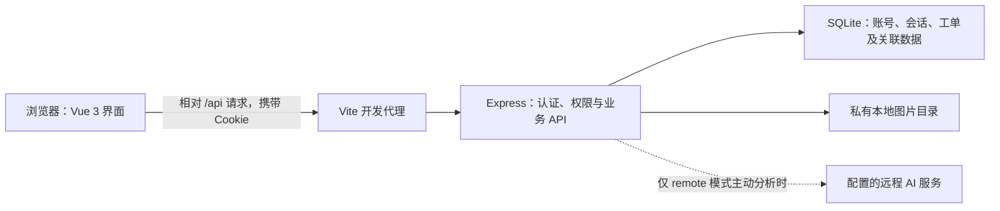

# 宿舍报修管理系统 V2.0

**企业级 AI 软件设计与开发综合实践 · 课程综合实践项目**

面向大学课程设计、项目答辩和校园后勤流程演示的宿舍报修系统。学生提交故障，维修人员接单处理，管理员管理维修账号并派单；系统保留工单状态、操作时间轴、评价和站内消息。

本项目以本地单实例部署为主，展示前后端分离、角色权限、SQLite 持久化及可选 AI 辅助分析的实现方式。本文依据当前源码整理，不包含真实账号、密钥或业务数据。

## 1. 技术栈与架构

| 层次 | 当前实现 |
| --- | --- |
| 前端 | Vue 3，使用组合式 API 和简单响应式状态 |
| 构建与开发服务 | Vite 8、`@vitejs/plugin-vue` |
| 后端 | Node.js ES Modules、Express 5、CORS |
| 数据库 | Node.js 内置 `node:sqlite` 的 `DatabaseSync`，本地 SQLite 文件 |
| 认证 | SQLite 会话、HttpOnly Cookie、Node.js 内置 `crypto.scrypt` |
| 文件存储 | 后端本地目录保存图片，SQLite 保存附件元数据 |
| AI | Node.js 内置 `fetch`；支持本地规则演示及可配置的远程 Chat Completions 服务 |
| 测试 | Node.js 内置 `node:test`；Chrome/Edge DevTools 无头浏览器联调 |

未引入 ORM、JWT、Pinia、Vue Router、WebSocket 或 AI SDK。仓库根目录没有 `package.json`，前后端分别管理依赖和脚本。文档中的 V2.0 表示功能阶段，子项目 `package.json` 仍保留各自原有版本号。



开发环境通过 Vite 转发 `/api`；生产环境需要自行配置静态站点与 API 反向代理。Express 当前不负责托管 `frontend/dist`。

## 2. 角色与权限边界

角色来自真实账号和后端会话，不提供演示身份切换。列表、详情和统计的权限范围由后端 SQL 限定。

| 能力 | 学生 | 维修人员 | 管理员 |
| --- | --- | --- | --- |
| 账号来源 | 公开注册学生账号 | 管理员创建 | 本地 CLI 首次初始化 |
| 创建报修 | 可以，归属由会话确定 | 不允许 | 不允许 |
| 工单列表和详情 | 仅本人工单 | 未分配待处理工单，以及本人负责工单 | 全部工单，包括历史未归属工单 |
| 接单与状态推进 | 不允许 | 接单池接单，仅推进本人任务 | 不直接推进维修状态 |
| 派单、改派 | 不允许 | 不允许 | 派单待处理工单、改派已接单工单 |
| 维修账号管理 | 不允许 | 不允许 | 创建、查看、停用维修账号 |
| 评价读取 | 仅本人已完成工单 | 不允许 | 可查看 |
| 评价提交 | 仅本人已完成、未评价工单 | 不允许 | 不允许代评 |
| 统计范围 | 本人工单 | 本人负责工单，不含公共待接单池 | 全量工单 |
| 图片读取 | 本人工单 | 接单后仅当前负责工单 | 全部工单 |
| 消息中心 | 本人消息 | 本人消息 | 本人消息，不提供他人消息查询 |
| AI 分析 | 可选使用 | 不允许 | 不允许 |

维修人员接单前只能看到编号、类别、状态、时间等必要信息，不能读取学生身份、联系方式、宿舍、故障描述或照片。时间轴接口也不会公开待接单工单的操作记录。

普通注册接口不能创建管理员或维修人员。管理员也不能绕过状态机直接完成工单。

## 3. 核心功能

### 3.1 报修及状态流转

合法类别固定为 **水电、家具、网络、门窗、其他**，不由 AI 或客户端自行扩充。

```text
待处理 → 已接单 → 维修中 → 已完成
```

- 创建时由服务端生成编号、归属、初始状态和时间。
- 维修人员接单时，同时绑定负责人并将状态变为已接单。
- 管理员首次派单同样执行待处理到已接单；仅已接单工单允许改派。
- 维修中、已完成不可改派；状态不能跳级、回退或重复推进。
- 条件更新检查旧状态、负责人及更新时间，竞争失败返回 409。
- 列表提供状态/类别筛选，详情按当前权限重新查询。

前端展示编号是 `order_no`，API 路径中的 `:id` 是数据库整数主键，两者不可混用。

### 3.2 持久化维修时间轴

记录提交、接单、派单、改派、开始维修及维修完成事件，显示真实时间和操作者显示名称。

业务更新与操作日志在同一数据库事务中提交，失败不产生虚假记录；日志表有只追加约束。历史缺失记录明确标注“不完整”，不根据旧时间字段推造过去的操作或操作者。未发生步骤不显示虚构时间。

### 3.3 站内通知

- 新工单通知当时启用的管理员。
- 接单、派单、开始及完成通知所属学生。
- 管理员派单通知新负责人；改派分别通知原负责人和新负责人。
- 历史无学生归属的工单不发送学生通知；停用或角色不符的账号不接收新通知。
- 通知与业务更新、操作日志同事务提交，内容使用不含联系方式的固定文案。
- 消息中心支持分页、未读数量、单条/全部已读及手动刷新。
- 点击消息关联工单会重新验证当前权限；改派后的原负责人可能已无权查看。

没有 WebSocket、邮件、短信或浏览器推送。消息不承诺实时到达，需要打开或刷新消息中心获取最新结果。

### 3.4 故障图片附件

学生可选 1～3 张 JPEG、PNG、WebP 照片，单张不超过 5MiB；支持提交前预览、移除和详情大图。

- 先创建工单，再调用独立受保护附件接口。
- 若工单成功、照片失败，界面分别说明结果并支持重试，不重复创建工单。
- 后端检查真实字节特征、容器结构及 MIME 一致性，不相信原文件名。
- 额外限制单边 20000 像素、总像素 4000 万；重复及并发上传不能突破每单 3 张。
- 随机文件名、排他创建；图片目录不作为公开静态目录。
- 二进制读取须鉴权，响应包含正确 MIME、`nosniff` 和禁止缓存策略。
- 退出、移除预览或关闭详情时清理对象 URL，旧账号响应不会回流到新账号页面。

文件系统和 SQLite 无法完全原子提交。可捕获失败会回滚元数据、清理本次新文件；断电或进程被强制终止仍可能留下孤立文件，需备份后核查。本版不压缩重编码，也不清除 EXIF。

### 3.5 评价与统计

学生仅能评价本人已完成工单，每单一次；评分为整数 1～5，评论选填且不超过 500 字。

统计来自 SQLite 实时聚合，包含总数、状态分布、类别分布、已完成数和完成率，按角色限制范围。空范围返回合法零值，不使用预置展示数据。

### 3.6 AI 辅助分析

在学生报修表单点击“AI 智能分析”，根据 8～500 字符的故障描述提供类别、可能原因及安全建议。学生可以采用或忽略，AI 不自动提交、派单或修改工单状态。

| 模式 | 行为与标识 |
| --- | --- |
| 未设置或其他非启用值 | 接口返回未启用提示，普通报修不受影响 |
| `AI_MODE=rules` | 本地关键词与预设文案，明确显示“规则演示（非大模型）”，不调用远程服务 |
| `AI_MODE=remote` | 使用配置的远程模型，成功后显示“真实 AI 分析”；失败不静默降级到规则模式 |

远程模型只选择合法类别和受限归因代码，后端将其映射为原因短句及安全预设建议，不直接展示模型自由生成的维修步骤。燃气、电气异常、严重漏水等会采用保守安全提示。

只向远程服务发送经过基础脱敏的故障描述，不转发姓名等其他表单字段、账号对象、照片或 Cookie。基础脱敏不能识别自由文本中的所有个人信息，使用者仍应避免在描述中填写个人资料。所有分析均明确标注 **“AI 建议仅供参考”**。

## 4. 项目结构

```text
dorm-repair-system/
├─ README.md
├─ backend/
│  ├─ package.json / package-lock.json
│  ├─ src/
│  │  ├─ server.js                 # 入口、端口、DB_PATH
│  │  ├─ app.js                    # 路由组装及工单业务
│  │  ├─ database.js / migrations.js
│  │  ├─ auth.js / accounts.js / permissions.js
│  │  ├─ admin.js                  # 维修账号和派单
│  │  ├─ repair-categories.js
│  │  ├─ repair-logs.js / notifications.js
│  │  ├─ attachments.js / image-format.js
│  │  └─ ai.js / ai-service.js
│  ├─ scripts/init-admin.js
│  ├─ test/                        # 后端集成与故障注入测试
│  ├─ test-support/                # 测试账号工具、合成图片样本
│  ├─ data/                        # 默认运行数据库，忽略 Git
│  ├─ uploads/                     # 默认照片目录，首次上传时创建
│  └─ *V2.md / AI-REPAIR.md         # 分功能实现说明
└─ frontend/
   ├─ package.json / package-lock.json
   ├─ vite.config.js
   ├─ src/
   │  ├─ App.vue / auth.js
   │  ├─ api/                      # 请求封装及业务 API
   │  ├─ components/
   │  │  ├─ AuthPage.vue / Dashboard.vue / AdminWorkers.vue
   │  │  ├─ RepairDetails.vue / RepairTimeline.vue
   │  │  ├─ ImagePicker.vue / RepairPhotos.vue
   │  │  ├─ EvaluationPanel.vue / StatisticsPage.vue
   │  │  └─ MessageCenter.vue / AiRepairAssistant.vue
   │  ├─ utils/
   │  └─ style.css
   ├─ test/client.test.js
   └─ scripts/browser-smoke.mjs
```

运行时目录可能尚不存在，不随仓库提供真实数据。子目录 README 中部分内容保留了 V1 开发阶段记录；当前运行方式和权限应以本文、对应 V2 说明及源码为准。

## 5. 环境要求与安装

- Node.js **≥24.4.0**，项目使用内置 `node:sqlite`；无需另装 SQLite 服务或数据库驱动。
- npm，随 Node.js 安装。
- Windows PowerShell；示例使用 `npm.cmd`，避免 PowerShell 对 `npm.ps1` 的执行策略影响。
- 浏览器人工验收可使用现代 Chromium 浏览器。
- 自动无头联调脚本目前检测 Windows 默认安装位置的 Chrome 或 Edge，无需安装 Playwright。

在已克隆/下载的项目根目录执行：

```powershell
node --version
npm.cmd --prefix backend ci
npm.cmd --prefix frontend ci
```

两个子项目均有锁文件，`ci` 根据锁文件安装并可能替换对应 `node_modules`。不要在根目录执行不存在的 `npm start` 或 `npm test`。

## 6. Windows PowerShell 快速开始

以下是**独立本地演示配置**，使用用户应用数据目录，不触碰仓库中可能存在的默认数据库。两个终端均先进入项目根目录。

### 6.1 终端一：数据库位置、首次管理员与后端

```powershell
$demoRoot = Join-Path ([Environment]::GetFolderPath('LocalApplicationData')) 'DormRepairSystemV2Demo'

$env:DB_PATH = Join-Path $demoRoot 'repairs.sqlite'
$env:UPLOAD_DIR = Join-Path $demoRoot 'uploads'
$env:PORT = '3000'
$env:NODE_ENV = 'development'
$env:AUTH_ALLOWED_ORIGINS = 'http://localhost:5173'
$env:AI_MODE = 'rules'

# 仅首次使用这个数据库时执行；已有管理员请跳过以下两行。
node backend/scripts/init-admin.js
if ($LASTEXITCODE -ne 0) { throw '管理员初始化未成功，请检查后再启动服务' }

npm.cmd --prefix backend start
```

初始化脚本交互输入用户名、显示名称及两次密码，密码不回显，不要将密码填进命令参数。用户名为 3～32 位字母、数字、下划线、点或短横线，首位须字母或数字；密码为 12～128 字符且不能全为空白，显示名称为 1～50 字符。

脚本只创建首位管理员，已有管理员（包括停用管理员）或同名用户时拒绝覆盖。没有默认管理员或公开管理员注册接口。

后端默认地址为 `http://localhost:3000`；健康检查为 `http://localhost:3000/api/health`。开发时也可将最后一行替换为：

```powershell
npm.cmd --prefix backend run dev
```

`dev` 使用 Node 的 `--watch`，不要与 `start` 同时占用同一端口。使用 Ctrl+C 停止服务。

以后重启时重复设置同一组环境变量，再直接运行 `start`；不要重新创建数据库或重复初始化管理员。演示目录中的数据会保留。

### 6.2 终端二：前端

```powershell
$env:API_PROXY_TARGET = 'http://localhost:3000'
npm.cmd --prefix frontend run dev -- --host localhost --port 5173 --strictPort
```

访问 `http://localhost:5173`。`--strictPort` 避免 5173 被占用时自动换端口导致 Origin 校验失败。更换端口时同步调整后端 `AUTH_ALLOWED_ORIGINS`。

Vite 的代理保留浏览器 Origin（`changeOrigin:false`）。前端使用相对 `/api`，不要混用不同主机名，也不要在浏览器中直接伪造 Origin。

### 6.3 数据库初始化和已有数据升级

`openDatabase()` 会创建数据库所在目录、初始化缺失的 V1 业务表，并自动应用未执行的版本：

| 版本 | 内容 |
| --- | --- |
| 1 | `users`、`sessions`；工单增加可空 `student_id`、`assigned_worker_id` |
| 2 | `repair_logs`、时间排序索引及只追加约束 |
| 3 | `notifications`、接收者/未读索引及事件去重约束 |
| 4 | `repair_attachments`、工单索引及每单最多三张约束 |

`schema_migrations` 记录已应用版本；迁移 1～4 在同一事务中执行，重复打开不会重复增加字段或回填历史事件。原 V1 建表逻辑位于该事务之前。

**普通服务启动和管理员初始化都会调用迁移。** 启动在绑定端口之前打开数据库，因此端口占用导致启动失败，并不表示迁移没有发生。

已有数据升级前应停服，创建一致性备份并保留上传文件，先在副本演练、逐字段比较历史工单及评价，再处理原库。不要通过删除数据库“升级”。若使用 WAL，备份需正确处理主库和相关日志，不能运行中只复制主库或随意删除 WAL/SHM。

历史工单不按姓名、电话或宿舍自动关联学生，原主键、字段、状态及评价关联保留。新账号不会自动看到旧的未归属工单；管理员可以查看。已有历史维修中且无负责人的工单仍保持原样，当前没有专门接续或认领功能。

## 7. 环境变量

应用代码从进程环境读取配置，当前入口未自动加载 `.env`，仓库未提供 `.env.example`。以下默认值均来自实际代码。

| 变量 | 使用位置 | 默认或要求 |
| --- | --- | --- |
| `DB_PATH` | 后端、管理员脚本 | 默认 `backend/data/repairs.sqlite`；相对值按进程工作目录解析，建议绝对路径 |
| `UPLOAD_DIR` | 后端 | 默认 `backend/uploads`；相对值按工作目录解析，建议仓库外绝对路径 |
| `PORT` | 后端 | `3000`，范围 1～65535 的整数 |
| `NODE_ENV` | 后端 | 仅等于 `production` 时启用生产 Cookie/来源要求；本地示例显式设为 `development` |
| `AUTH_ALLOWED_ORIGINS` | 后端 | 逗号分隔的精确 Origin，不带路径或末尾斜线；生产必须显式配置 HTTPS Origin |
| `API_PROXY_TARGET` | Vite 开发代理 | `http://localhost:3000`；不是浏览器请求基地址，也不写入前端业务代码 |
| `AI_MODE` | 后端 | 未启用时返回 503；`rules` 为本地演示，`remote` 为远程模式 |
| `AI_PROVIDER` | 远程 AI | 必须为 `chat-completions` |
| `AI_ENDPOINT` | 远程 AI | 完整 HTTPS 接口地址；不允许 URL 凭据、查询参数、fragment 或自动重定向 |
| `AI_MODEL` | 远程 AI | 必填，提供商实际可用的模型标识 |
| `AI_API_KEY` | 远程 AI | 必填，仅在服务端保存；通过 Bearer 头认证，不放在请求正文或前端 |
| `AI_TIMEOUT_MS` | 远程 AI | 默认 `8000`，代码接受 1～20000 毫秒 |

开发环境未显式配置来源时，默认允许 localhost 和 127.0.0.1 的 5173、3000 端口。来源限制与角色授权是两层机制，不能用 CORS 代替业务权限。

### 启用远程 AI（可选）

先保持前述演示 `DB_PATH`、`UPLOAD_DIR` 和端口配置，停止后端，再设置：

```powershell
$env:AI_MODE = 'remote'
$env:AI_PROVIDER = 'chat-completions'
$env:AI_ENDPOINT = 'https://api.deepseek.com/chat/completions'
$env:AI_MODEL = '<替换为提供商实际支持 JSON 输出的模型标识>'

$aiSecret = Read-Host 'AI API Key' -AsSecureString
$aiCredential = [System.Management.Automation.PSCredential]::new('ai', $aiSecret)
$env:AI_API_KEY = $aiCredential.GetNetworkCredential().Password
Remove-Variable aiCredential, aiSecret

npm.cmd --prefix backend start
```

地址仅为兼容服务示例，须确认提供商协议、模型权限、费用和数据保留政策。不要原样使用模型占位符，也不要将密钥写入源码、命令历史或 `VITE_*` 前端配置。

未配置远程服务不影响规则演示及正常报修。远程服务失败会明确返回错误，不会冒充成功或自动切换规则模式。当前远程协议通过本地模拟服务验证，不声称已经接入某个真实账号或完成付费服务联调。

## 8. 课程展示流程

建议准备一个自建管理员、两个维修账号、两个学生账号，均使用演示资料。

1. **管理员准备**：通过 CLI 首次创建管理员，登录“维修人员”页面创建维修账号。不要公开展示密码。
2. **学生注册**：在登录页注册学生账号，使用真实登录进入工作台；另一个学生用于验证工单隔离。
3. **提交报修**：填写故障现象、类别、位置和演示联系方式，可选 AI 规则分析及 1～3 张照片，检查预览和移除功能。
4. **管理员派单**：查看全部工单及新工单通知，给待处理工单选择启用维修人员。若展示改派，应在开始维修前操作。
5. **维修处理**：负责人登录“我的维修任务”，读取详细信息和照片，依次开始维修、完成维修。另一条待处理工单可演示自主接单。
6. **学生验收**：查看状态、时间轴和通知，对本人已完成工单提交评价，检查本人统计。
7. **权限与并发**：切换账号验证学生只能看本人、未接单人员看不到隐私、改派后原负责人无法再访问工单；409 时刷新，不盲目重试写操作。
8. **会话与持久化**：刷新恢复登录，退出后确认页面及图片预览清理；使用相同数据路径重启后检查记录仍存在。

此流程用于教学演示，不代表已完成真实校园业务上线或可替代专业维修判断。

## 9. API 概览

除健康检查、学生注册和登录外，业务接口均需有效会话；退出接口保持幂等。写操作使用 JSON、可信 Origin 和 `X-Auth-Request:1`，前端请求携带 `credentials:'include'`。

| 方法 | 路径 | 用途 |
| --- | --- | --- |
| GET | `/api/health` | 数据库连通性检查 |
| POST | `/api/auth/register` | 学生注册 |
| POST | `/api/auth/login` | 登录并设置 Cookie |
| POST | `/api/auth/logout` | 撤销当前会话、清除 Cookie |
| GET | `/api/auth/me` | 当前登录用户 |
| GET / POST | `/api/repairs` | 角色范围列表 / 学生创建 |
| GET | `/api/repairs/:id` | 当前有权查看的工单详情 |
| POST | `/api/repairs/:id/accept` | 维修人员原子接单 |
| PATCH | `/api/repairs/:id/status` | 仅负责人推进合法下一状态 |
| PATCH | `/api/repairs/:id/assignment` | 管理员派单或改派 |
| GET | `/api/repairs/:id/timeline` | 持久化时间轴 |
| GET / POST | `/api/repairs/:id/evaluation` | 按权限读取 / 学生本人评价 |
| GET / POST | `/api/repairs/:id/attachments` | 按权限列图 / 学生上传 |
| GET | `/api/repairs/:id/attachments/:attachmentId/content` | 鉴权下载图片二进制 |
| GET | `/api/statistics` | 角色范围内的聚合统计 |
| GET / POST | `/api/admin/workers` | 管理员查看 / 创建维修账号 |
| PATCH | `/api/admin/workers/:id` | `{is_active:0}` 停用维修账号 |
| GET | `/api/notifications` | 本人消息，`page` 默认 1、`limit` 默认 20 |
| GET | `/api/notifications/unread-count` | 本人未读数 |
| PATCH | `/api/notifications/:id/read` | 本人单条已读 |
| PATCH | `/api/notifications/read-all` | 本人全部已读 |
| POST | `/api/ai/analyze-repair` | 学生可选故障分析 |

派单提交 `assigned_worker_id`、`expected_status`、`expected_assigned_worker_id`；前端同时提交 `expected_updated_at` 防止旧快照覆盖。

图片上传使用 JSON/base64，不是 multipart：`{files:[{mime,data}]}`。附件请求体最大 21MiB，解码后单张最大 5MiB；其他业务 JSON 默认 32KB。

接口通常返回 `{success:true,data:...}`，失败为 `{success:false,message:...}`。常见状态：

- 400：输入错误；401：未登录或会话失效；403：角色或来源禁止；404：不存在或私有资源无权访问。
- 409：状态、负责人或容量冲突。接单操作对已被领取、重复领取和不存在目标统一返回 409，避免披露资源信息。
- 413：请求或照片超限；415：请求格式不支持；429：限流。
- AI 的 502/503/504 分别表示上游/格式问题、未启用或配置问题、超时，不影响普通报修。

## 10. 测试与构建

### 10.1 命令和写入边界

以下命令从项目根目录运行。后端和浏览器测试会创建临时数据库、模拟账号或照片，不以默认数据库执行迁移；前端请求测试使用模拟 fetch。

部分现有测试的指纹保护逻辑假定 `backend/data` 目录存在，而 Git 不保存空目录。首次克隆后，先只创建这个空目录，**无需创建或迁移默认数据库**：

```powershell
New-Item -ItemType Directory -Path backend/data -Force | Out-Null

npm.cmd --prefix backend test
node --test frontend/test/client.test.js
npm.cmd --prefix frontend run build
node frontend/scripts/browser-smoke.mjs
```

| 命令 | 实际行为 |
| --- | --- |
| 后端 `test` | `node --test`；使用系统临时 SQLite 文件，附件测试使用临时上传目录，AI 使用本机模拟服务 |
| 前端请求测试 | Node 内置测试运行器，无需数据库，无真实 AI 调用 |
| 前端 `build` | 生成 `frontend/dist`，无需数据库 |
| 浏览器联调 | 启动临时数据库后端、Vite 和无头 Chrome/Edge；临时照片、浏览器配置及截图写入系统临时目录，结束关闭测试服务 |

测试对默认数据库文件做只读指纹检查，部分测试会读取其字节计算哈希，不把业务写入或迁移应用到它。后端原 API 测试固定使用 3107 端口，运行前需确保空闲；浏览器脚本使用空闲端口。

浏览器脚本目前只检测：
- `C:/Program Files/Google/Chrome/Application/chrome.exe`
- `C:/Program Files (x86)/Microsoft/Edge/Application/msedge.exe`

未安装或安装位置不同会失败，需另行适配脚本。测试临时产物可能保留供排查，不应提交仓库。

故障注入测试中的 `no such table`、`injected log/notification/attachment failure` 及浏览器附件失败日志属于预期测试场景，应结合最终断言结果判断。

### 10.2 已有验证记录

当前测试源码包含 **59 项后端测试、8 项前端请求测试、10 组浏览器流程**。

课程验收前已在本地重新执行全部验证，结果如下（执行环境：Windows、Node.js v22.22.2）：

| 验证项 | 命令 | 结果 |
| --- | --- | --- |
| 后端测试 | `npm.cmd --prefix backend test` | **59 / 59 通过** |
| 前端请求测试 | `node --test frontend/test/client.test.js` | **8 / 8 通过** |
| 浏览器联调 | `node frontend/scripts/browser-smoke.mjs` | **10 / 10 组流程通过** |
| 前端构建 | `npm.cmd --prefix frontend run build` | **构建成功**（30 个模块，dist 产物约 138KB） |

后端与浏览器测试均使用系统临时目录下的独立 SQLite 数据库与临时上传目录，**不读写、不迁移默认数据库 `backend/data/repairs.sqlite`**。浏览器联调覆盖 375px 视口溢出检查，并自动生成移动端截图。

以上结果仅代表本次本地验证，不表示所有操作系统、浏览器版本或真实远程 AI 服务均已验证；远程 AI（`AI_MODE=remote`）当前仅通过本地模拟服务验证协议，未接入真实付费服务。实际结果以运行输出为准。

### 10.3 构建与部署区别

```powershell
npm.cmd --prefix frontend run build
```

该命令只构建前端，不会将页面部署到 Express。`npm.cmd --prefix frontend run preview` 是构建预览，当前 Vite 配置仅设置了开发服务 `server.proxy`，不能将预览服务视为已接通后端的完整部署。

正式部署需自行托管 `frontend/dist`、同源代理 `/api`，启用 HTTPS，设置 `NODE_ENV=production` 和精确信任的 HTTPS Origin，并配置持久数据目录、请求体上限和上传超时。

## 11. 安全、持久化与仓库数据

- 密码使用异步 scrypt 和独立盐；会话使用随机令牌，SQLite 仅保存摘要。Cookie 为 HttpOnly、SameSite=Lax，生产增加 Secure。
- 每次受保护请求检查有效期及账号启用状态，停用维修账号会撤销其会话。
- 后端参数化 SQL、角色与归属校验、Origin/专用请求头校验共同保护业务；前端隐藏按钮不能代替授权。
- 普通登录/注册及 AI 有基础内存限流；不信任客户端伪造的 `X-Forwarded-For`。
- 前端不以 localStorage 保存账号密钥或会话令牌；退出/401 时清空角色页面，防止旧异步数据重新显示。
- 数据默认持久化到文件，重启不会清空。数据库、照片及备份是独立的运行数据，不包含在应用源码分发中。
- 根目录 `.gitignore` 已提供通用忽略规则：环境变量与密钥（`.env`、`.env.*`，并通过 `!.env.example`、`!.env.*.example` 保留示例模板可跟踪）、SQLite 数据库及 WAL/SHM 日志（`*.sqlite*`）、WorkBuddy 工作区数据（`.workbuddy/`）、依赖与构建产物；子目录另有默认上传目录与日志规则。即便如此，仍不建议在仓库内创建含密钥的环境文件，应通过进程环境或部署平台注入。
- 自定义数据库、上传和备份路径若放入仓库，不一定被现有规则覆盖，应在发布前单独检查。不得提交用户照片、数据库/WAL/SHM、会话、日志中的敏感信息或 API Key。
- 上传图片与数据库应一起备份；还原 V1 数据库后若直接启动 V2，会再次自动迁移。重要升级应先停服、备份和副本演练。
- 删除源码或运行 `npm ci` 不会替你安全清理运行数据；不要以删除数据库解决权限、迁移或登录问题。

仓库当前未提供 `LICENSE`，本文不声明 MIT 等开源许可。正式公开分发前，应由维护者选择并补充许可证及第三方资源许可说明。

## 12. 当前限制与改进方向

1. 面向本地单实例教学演示，不包含自动部署、监控告警、备份调度或完整生产运维方案。
2. 工单列表尚无后端分页；通知使用有界页码分页，默认 20 条，最多 50 条/页，页码上限 1000。
3. 站内消息依赖手动获取，没有实时推送；限流存于单进程内存，重启会重置。
4. 不提供自助找回密码、完整账号生命周期、管理员恢复或历史工单认领。
5. 停用维修人员不会自动改派任务；维修中不能改派，历史无负责人的维修中工单需制定独立、可审计的处理流程。
6. 图片使用同步、有限大小的本地文件处理与 base64 传输，存在内存/带宽开销；尚无缩略图生成、EXIF 清除、完整解码转码、病毒扫描或自动孤立文件治理。
7. AI 原因及建议受安全模板约束，不是自由诊断；基础脱敏存在边界，真实服务的费用、隐私及协议兼容需人工确认。
8. 子目录部分 README 为旧阶段记录；仓库尚未提供 `.env.example` 环境配置模板与开源许可证，公开发布前需维护者处理。
9. 浏览器脚本有 Windows 安装路径假设；现有指纹测试要求默认数据目录存在，跨平台与首次克隆体验可进一步改善。

后续可按需求引入后端工单分页、共享限流、受控密码恢复、迁移审计、联合备份恢复工具、图片流式存储和跨平台 CI，避免在课程演示阶段引入无必要的基础设施。

## 13. 课程验收文档

- [系统设计文档](docs/DESIGN.md)：需求分析、总体架构、技术选型、角色权限、数据库设计、状态流转、API、测试方案与结果
- [AI 辅助开发过程说明](docs/AI-DEV-PROCESS.md)：AI 参与各阶段的方式、人机分工、质量对策与待人工补充清单

## 14. 分功能说明

- [认证与会话](backend/AUTH-V2.md)
- [角色权限与管理员派单](backend/PERMISSIONS-V2.md)
- [前端登录接入](frontend/V2-LOGIN.md)
- [维修时间轴](backend/TIMELINE-V2.md)
- [站内通知](backend/NOTIFICATIONS-V2.md)
- [照片附件](backend/ATTACHMENTS-V2.md)
- [AI 配置与安全边界](backend/AI-REPAIR.md)
