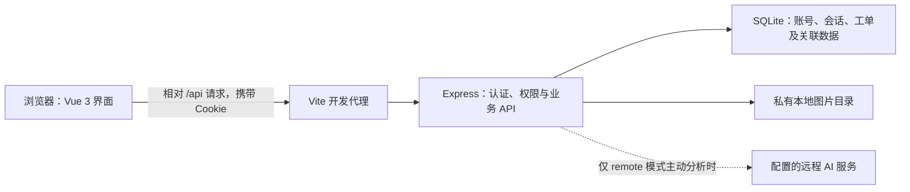
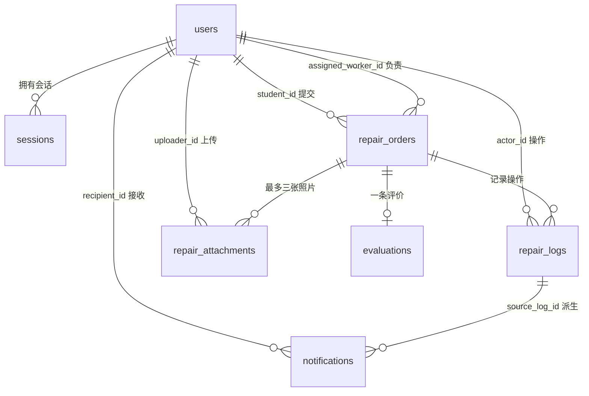
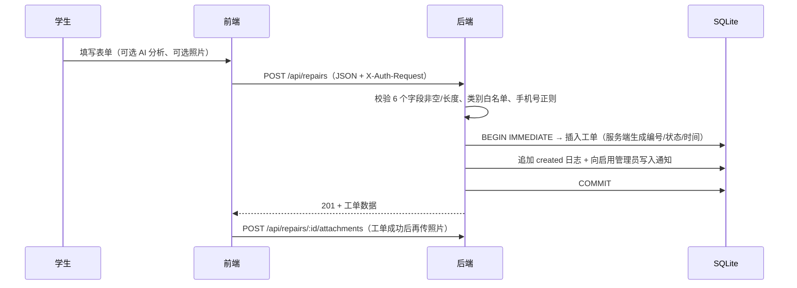
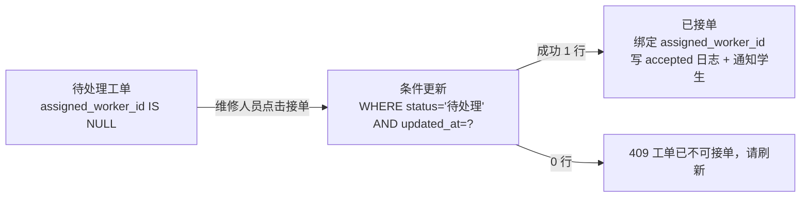
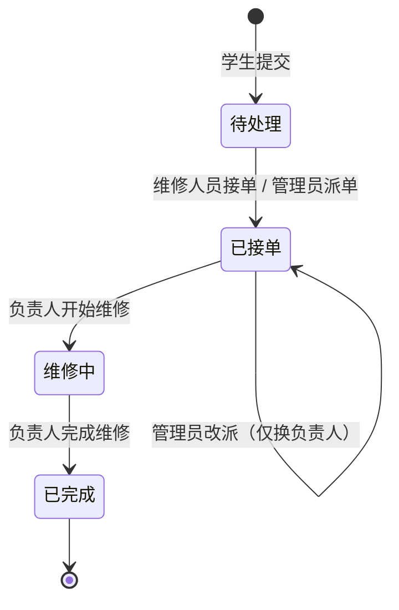

# 宿舍报修管理系统 V2.0 系统设计文档

> 课程：企业级 AI 软件设计与开发综合实践
> 版本：V2.0（对应提交 `d5867e1`）
> 本文内容依据当前仓库源码整理，所有字段、接口、约束与测试结果均以实际代码为准。

---

## 1. 项目背景

高校宿舍设施故障（水电、家具、网络、门窗等）传统上依赖纸质登记或口头报修，存在**进度不可追踪、责任人不明确、学生无法反馈、管理人员缺少统计依据**等问题。

本项目面向大学课程综合实践，实现一个**三角色（学生 / 维修人员 / 管理员）闭环**的宿舍报修管理系统，目标如下：

1. 学生可自助提交报修，并全程查看进度、时间轴与通知，完成后可评价。
2. 维修人员可**自主接单**，也可由管理员派单；仅能处理本人负责的工单。
3. 管理员可管理维修账号、派单与改派，并查看全量工单与统计。
4. 全过程可追溯：每一次状态变化都产生持久化时间轴与站内通知。
5. 引入**可选 AI 辅助分析**，在不改变业务状态、不自动派单的前提下给出类别与安全建议。

定位说明：本项目是**本地单实例教学演示系统**，用于课程设计与答辩，不代表已上线真实校园业务，也不替代专业维修判断。

---

## 2. 需求分析

### 2.1 功能性需求

| 编号 | 需求 | 对应实现 |
| --- | --- | --- |
| F1 | 学生注册与学生账号登录 | `POST /api/auth/register`、`POST /api/auth/login` |
| F2 | 学生提交报修（含类别、位置、描述、联系方式） | `POST /api/repairs` |
| F3 | 报修可选上传 1～3 张故障照片 | `POST /api/repairs/:id/attachments` |
| F4 | 学生查看本人报修列表与详情 | `GET /api/repairs`、`GET /api/repairs/:id` |
| F5 | **维修人员自主接单** | `POST /api/repairs/:id/accept` |
| F6 | **按类型 / 状态筛选工单** | 前端 `Dashboard.vue` 中 `statusFilter` / `categoryFilter` 计算属性过滤 |
| F7 | 维修人员推进状态（开始维修 / 完成维修） | `PATCH /api/repairs/:id/status` |
| F8 | 管理员创建、查看、停用维修账号 | `/api/admin/workers` |
| F9 | 管理员派单与改派 | `PATCH /api/repairs/:id/assignment` |
| F10 | 工单操作时间轴持久化 | `GET /api/repairs/:id/timeline` |
| F11 | 站内消息通知（新单、接单、派单、改派、开始、完成） | `/api/notifications` |
| F12 | 学生对本人已完成工单评价（1～5 分 + 选填评论） | `POST /api/repairs/:id/evaluation` |
| F13 | 按角色范围的统计（总数、状态分布、类别分布、完成率） | `GET /api/statistics` |
| F14 | 可选 AI 故障分析（类别、可能原因、安全建议） | `POST /api/ai/analyze-repair` |
| F15 | **异常输入处理** | 各接口的字段校验、类型校验、长度与格式校验 |
| F16 | **非法状态跳转防护** | 服务端状态机白名单 + 条件更新 |
| F17 | **权限控制** | 会话 + 角色 + SQL 层数据范围三重约束 |

### 2.2 非功能性需求

| 类别 | 要求 | 实现方式 |
| --- | --- | --- |
| 安全性 | 密码不可逆存储、会话不可伪造、越权不可达 | scrypt + 随机盐；会话令牌仅存 SHA-256 摘要；全部查询参数化 |
| 一致性 | 业务更新、时间轴、通知必须同时成功或同时失败 | 同一 SQLite 事务提交；日志表只追加 |
| 并发安全 | 两人同时接单只能成功一人 | 条件更新（`WHERE status = ? AND updated_at = ?`）+ `BEGIN IMMEDIATE` |
| 可追溯性 | 历史不虚构 | 缺失的早期记录标注"不完整"，不依据旧字段反推操作者 |
| 可移植性 | 免安装数据库服务 | Node.js 内置 `node:sqlite` + 单文件 SQLite |
| 易用性 | 移动端可用 | 响应式布局，浏览器联调含 375px 视口检查 |

### 2.3 角色用例

- **学生**：注册 → 登录 → 提交报修（可选 AI 分析 + 照片）→ 查看进度与时间轴 → 接收通知 → 评价 → 查看个人统计。
- **维修人员**：登录 → 浏览待接单池（仅编号/类别/状态/时间）→ 自主接单 → 查看详情与照片 → 开始维修 → 完成维修 → 查看个人统计。
- **管理员**：CLI 初始化 → 登录 → 创建维修账号 → 查看全量工单 → 派单 / 改派 → 停用维修账号 → 查看全量统计。

---

## 3. 总体架构



**分层结构**

| 层次 | 职责 | 主要文件 |
| --- | --- | --- |
| 表现层 | Vue 3 单页界面、表单校验、状态展示 | `frontend/src/components/*.vue` |
| 接口层 | 统一请求封装、凭据携带、账号切换隔离 | `frontend/src/api/client.js` |
| 路由与控制层 | Express 路由、参数校验、错误映射 | `backend/src/app.js`、`admin.js`、`attachments.js`、`notifications.js`、`ai.js` |
| 领域服务层 | 状态机、权限范围、事务与日志、通知、图片检测 | `backend/src/permissions.js`、`repair-logs.js`、`notifications.js`、`image-format.js`、`ai-service.js` |
| 数据访问层 | 建表、版本迁移、参数化 SQL | `backend/src/database.js`、`migrations.js` |
| 存储层 | SQLite 文件 + 本地私有图片目录 | `backend/data/`、`backend/uploads/` |

**部署形态**：开发环境由 Vite 代理 `/api` 到 Express；生产环境需自行托管 `frontend/dist` 并同源反向代理 `/api`。当前 Express **不负责托管前端构建产物**。

---

## 4. 技术选型

| 层次 | 选型 | 选择理由 |
| --- | --- | --- |
| 前端框架 | Vue 3（组合式 API） | 响应式模型简单，组件化清晰，适合中等规模界面 |
| 构建工具 | Vite 8 + `@vitejs/plugin-vue` | 启动快，开发代理配置简单 |
| 后端运行时 | Node.js ES Modules | 与前端同语言，降低课程项目的技术栈切换成本 |
| Web 框架 | Express 5 | 中间件模型成熟，路由与错误处理直观 |
| 数据库 | SQLite（`node:sqlite` 的 `DatabaseSync`） | 零安装、单文件、支持事务与触发器；便于演示与备份 |
| 认证 | 自建会话 + HttpOnly Cookie + `crypto.scrypt` | 不引入 JWT 等额外依赖，会话可在服务端即时撤销 |
| 测试 | Node.js 内置 `node:test` + 无头 Chrome/Edge DevTools 协议 | 无需安装测试框架或 Playwright |
| AI | 内置 `fetch`，本地规则模式 + 可选远程 Chat Completions | 无 AI SDK 依赖；未配置时不影响正常报修 |

**未引入**：ORM、JWT、Pinia、Vue Router、WebSocket、AI SDK。状态管理使用 Vue `reactive` 模块，页面切换使用组件内状态而非路由。

---

## 5. 角色与权限模型

### 5.1 权限矩阵

| 能力 | 学生 | 维修人员 | 管理员 |
| --- | --- | --- | --- |
| 账号来源 | 公开注册 | 管理员创建 | 本地 CLI 首次初始化 |
| 创建报修 | ✅（归属由会话确定） | ❌ | ❌ |
| 工单列表 / 详情 | 仅本人工单 | 未分配待处理工单 + 本人负责工单 | 全部工单 |
| 接单与状态推进 | ❌ | ✅（接单池接单，仅推进本人任务） | ❌ |
| 派单 / 改派 | ❌ | ❌ | ✅ |
| 维修账号管理 | ❌ | ❌ | ✅（创建、查看、停用） |
| 评价读取 | 仅本人已完成工单 | ❌ | ✅ |
| 评价提交 | ✅（本人已完成、未评价） | ❌ | ❌（不可代评） |
| 统计范围 | 本人工单 | 本人负责工单（**不含公共待接单池**） | 全量工单 |
| 图片读取 | 本人工单 | 接单后仅本人负责工单 | 全部工单 |
| 消息中心 | 本人消息 | 本人消息 | 本人消息 |
| AI 分析 | ✅（可选） | ❌ | ❌ |

### 5.2 三层约束机制

1. **会话层**：`requireSession` 校验 Cookie 中的会话令牌摘要、有效期与账号启用状态，失败返回 401。
2. **角色层**：`requireRoles(...)` 校验角色，失败返回 403。
3. **数据范围层**：`orderScope()` 生成 SQL 条件，管理员 `1=1`、学生 `student_id = ?`、维修人员 `assigned_worker_id = ? OR (status='待处理' AND assigned_worker_id IS NULL)`。**越权资源一律按 404 处理**，不泄露存在性。

### 5.3 维修人员隐私隔离（重点设计）

维修人员**接单前**不允许读取学生隐私。实现方式是在 SQL 投影层而非界面层屏蔽：

```js
// permissions.js：未分配工单的私有字段被投影为 NULL
CASE WHEN assigned_worker_id IS NOT NULL THEN building END AS building
```

序列化时再按 `publicPendingFields` 白名单裁剪，仅保留 `id`、`order_no`、`category`、`status`、`created_at`、`updated_at`、`assigned_worker_id`。时间轴接口对未接单工单返回 `events: []`、`redacted: true`、`history_incomplete: null`。

**前端隐藏按钮不能代替后端授权**——所有过滤均在服务端完成。

---

## 6. 数据库设计

### 6.1 实体关系



### 6.2 表结构

| 表名 | 关键字段与约束 | 说明 |
| --- | --- | --- |
| `users` | `id`、`username`（UNIQUE、NOCASE）、`password_hash`、`display_name`（1–50）、`role` ∈ {student, worker, admin}、`is_active` ∈ {0,1}、`created_at` | 账号主表 |
| `sessions` | `token_hash`（PK，存 SHA-256 摘要）、`user_id`（外键级联）、`expires_at`、`created_at` | 会话表，**不存明文令牌** |
| `repair_orders` | `id`、`order_no`（UNIQUE）、`building`、`room`、`category` ∈ {水电,家具,网络,门窗,其他}、`description`、`contact_name`、`contact_phone`、`status`（默认"待处理"）、`created_at`、`updated_at`、`student_id`、`assigned_worker_id` | 工单主表（V1 表 + V2 迁移字段） |
| `evaluations` | `id`、`repair_order_id`（**UNIQUE**，一单一条）、`rating`（整数 1–5）、`comment`（≤500）、`created_at` | 评价表 |
| `repair_logs` | `id`、`repair_order_id`、`event_type` ∈ {created, accepted, assigned, reassigned, started, completed}、`actor_id`、`actor_display_name`、`actor_role`、`occurred_at`、`from_status`、`to_status`、`from_worker_id`、`to_worker_id` | 操作日志，**只追加** |
| `notifications` | `id`、`recipient_id`、`event_type`、`repair_order_id`、`source_log_id`、`title`（1–100）、`content`（1–500）、`created_at`、`read_at`、`UNIQUE(recipient_id, source_log_id)` | 站内消息，去重约束防重复 |
| `repair_attachments` | `id`、`repair_order_id`、`uploader_id`、`storage_name`（UNIQUE，32 位十六进制）、`mime_type` ∈ {jpeg,png,webp}、`byte_size`（1–5242880）、`created_at` | 照片元数据 |
| `schema_migrations` | `version`（PK）、`applied_at` | 迁移版本记录 |

### 6.3 约束与触发器

| 名称 | 作用 |
| --- | --- |
| `repair_logs_no_update` / `repair_logs_no_delete` | 日志表只追加，任何 UPDATE/DELETE 直接 `RAISE(ABORT)` |
| `repair_attachments_limit` | 插入前检查同单附件数 ≥3 则中止，保证每单最多三张 |
| `UNIQUE(recipient_id, source_log_id)` | 同一日志对同一接收者只产生一条通知 |
| `UNIQUE(repair_order_id)`（evaluations） | 数据库层最终防线，杜绝重复评价 |
| `CHECK` 约束 | 类别、状态、角色、评分、MIME、字节数等枚举与范围在库内强制 |

### 6.4 迁移策略

`openDatabase()` 先创建 V1 业务表（幂等 `CREATE TABLE IF NOT EXISTS`），再执行 `migrateDatabase()`，迁移 1～4 在**同一事务**中按版本应用：

| 版本 | 内容 |
| --- | --- |
| 1 | `users`、`sessions`；工单增加可空 `student_id`、`assigned_worker_id` 及索引 |
| 2 | `repair_logs`、排序索引、只追加触发器 |
| 3 | `notifications`、接收者/未读索引、事件去重约束 |
| 4 | `repair_attachments`、工单索引、每单三张上限触发器 |

**设计原则：只增量、不重建、不回填。** 历史工单不按姓名/电话/宿舍自动关联学生，历史操作不反推补写日志与通知；原主键、字段、状态与评价关联全部保留。

---

## 7. 核心业务流程

### 7.1 报修提交



关键点：**先建单、后传照片**。照片失败时界面分别提示并支持重试，不会重复创建工单。客户端传入的 `order_no`、`status`、`student_id` 等同名字段一律由服务端生成并忽略。

### 7.2 维修人员自主接单



接单接口对"已被领取""重复领取""工单不存在"**统一返回 409**，避免通过状态码探测资源是否存在。

### 7.3 派单与改派

- 管理员提交 `assigned_worker_id`、`expected_status`、`expected_assigned_worker_id`（前端另附 `expected_updated_at`）。
- 后端在 `BEGIN IMMEDIATE` 事务中比对旧快照，任一不一致即 409 回滚。
- 仅"待处理"（无负责人）与"已接单"允许派单；**维修中、已完成不可改派**。
- 目标必须是启用状态的维修人员账号，否则 400。
- 改派会通知原负责人（撤销通知）与新负责人，原负责人立即失去访问权。

### 7.4 评价

学生仅能对**本人已完成且未评价**的工单提交一次评价；评分为整数 1～5，评论选填且 ≤500 字。拦截顺序为：权限 → 状态（409）→ 参数（400）→ 唯一性（409，含数据库 UNIQUE 兜底）。

### 7.5 通知与时间轴

同一个业务事务内依次完成：**更新工单 → 追加日志 → 按事件类型派生通知 → 提交**。任一步失败整体回滚，不产生"工单改了但没记录"或"记录了但没通知"的中间态。

通知接收规则：新工单通知**当时启用的管理员**；接单/派单/开始/完成通知所属学生；派单同时通知新负责人；改派分别通知原、新负责人。历史无学生归属的工单不发送学生通知；停用或角色不符的账号不接收。

---

## 8. 状态流转设计



**状态机实现**（`app.js`）：

```js
const nextStatus = new Map([['待处理', '已接单'], ['已接单', '维修中'], ['维修中', '已完成']])
```

规则：

1. 不接受任何不在白名单内的状态值（400）。
2. `nextStatus.get(当前状态) !== 目标状态` 时返回 409，**禁止跳级、回退与重复推进**。
3. 已完成工单不可再操作；管理员也不能绕过状态机直接完成工单。
4. 状态推进只允许工单负责人执行（`assigned_worker_id = 会话用户 id`）。

**并发控制**：所有写操作使用条件更新，条件包含 `status`、`assigned_worker_id` 与 `updated_at`（乐观锁），并置于 `BEGIN IMMEDIATE` 事务中，冲突返回 409 并提示刷新。`nextUpdatedAt()` 保证时间戳单调递增（不小于当前时间且严格大于旧值）。

---

## 9. 主要 API 设计

统一约定：除健康检查、注册、登录外均需有效会话；写操作需 `Content-Type: application/json`、`X-Auth-Request: 1` 与可信 Origin；成功返回 `{success:true,data:...}`，失败返回 `{success:false,message:...}`。

| 方法 | 路径 | 用途 | 角色 |
| --- | --- | --- | --- |
| GET | `/api/health` | 数据库连通性检查 | 公开 |
| POST | `/api/auth/register` | 学生注册 | 公开 |
| POST | `/api/auth/login` | 登录并设置 Cookie | 公开 |
| POST | `/api/auth/logout` | 撤销会话（幂等） | 登录用户 |
| GET | `/api/auth/me` | 当前登录用户 | 登录用户 |
| GET | `/api/repairs` | 角色范围内工单列表 | 全部 |
| POST | `/api/repairs` | 创建报修 | student |
| GET | `/api/repairs/:id` | 工单详情（按权限） | 全部 |
| POST | `/api/repairs/:id/accept` | **自主接单**（原子） | worker |
| PATCH | `/api/repairs/:id/status` | 推进合法下一状态 | worker |
| PATCH | `/api/repairs/:id/assignment` | 派单 / 改派 | admin |
| GET | `/api/repairs/:id/timeline` | 持久化时间轴 | 全部（按权限裁剪） |
| GET / POST | `/api/repairs/:id/evaluation` | 读取 / 提交评价 | student（读：admin 可） |
| GET / POST | `/api/repairs/:id/attachments` | 列图 / 上传照片 | student 上传；按权限读取 |
| GET | `/api/repairs/:id/attachments/:attachmentId/content` | 鉴权读取图片二进制 | 按权限 |
| GET | `/api/statistics` | 角色范围统计 | 全部 |
| GET / POST | `/api/admin/workers` | 查看 / 创建维修账号 | admin |
| PATCH | `/api/admin/workers/:id` | 停用维修账号（`is_active:0`） | admin |
| GET | `/api/notifications` | 本人消息（分页） | 登录用户 |
| GET | `/api/notifications/unread-count` | 未读数量 | 登录用户 |
| PATCH | `/api/notifications/:id/read` | 单条已读（幂等） | 登录用户 |
| PATCH | `/api/notifications/read-all` | 全部已读（幂等） | 登录用户 |
| POST | `/api/ai/analyze-repair` | 故障分析（可选） | student |

**状态码约定**：400 输入错误；401 未登录/会话失效；403 角色或来源禁止；404 不存在或无权限访问该资源；409 状态/负责人/容量冲突；413 请求或照片超限；415 请求格式不支持；429 限流；AI 的 502/503/504 分别表示上游问题、未启用或配置问题、超时。

**说明**：路径中的 `:id` 是数据库整数主键，界面展示的编号是 `order_no`，两者不可混用。图片上传采用 JSON + base64（非 multipart），附件请求体上限 21MiB，其他业务 JSON 上限 32KB。

---

## 10. 前端设计要点

| 组件 | 职责 |
| --- | --- |
| `App.vue` | 会话恢复与页面切换（登录页 / 工作台） |
| `AuthPage.vue` | 注册与登录表单 |
| `Dashboard.vue` | 工作台主体：列表、筛选、接单、状态推进、派单、评价入口 |
| `RepairDetails.vue` / `RepairTimeline.vue` / `RepairPhotos.vue` | 详情、时间轴、照片展示 |
| `ImagePicker.vue` | 照片选择、预览、移除与对象 URL 清理 |
| `EvaluationPanel.vue` | 评价展示与提交 |
| `StatisticsPage.vue` | 按角色范围的统计面板 |
| `MessageCenter.vue` | 消息列表、未读数、已读操作 |
| `AdminWorkers.vue` | 维修账号创建与停用 |
| `AiRepairAssistant.vue` | AI 分析触发与结果采用/忽略 |

**请求隔离设计**（`api/client.js`）：全局 `generation` 计数器，退出或 401 时自增并 `abort` 所有在途请求。每个请求在发起前记录代号，响应解析完成后再次比对，不一致则抛出 `STALE` 错误并丢弃结果——**防止旧账号的响应回流到新账号页面**（含图片 blob 与对象 URL）。

**筛选实现**：工单列表由后端按角色范围一次性返回，前端用 `statusFilter` / `categoryFilter` 两个响应式变量配合计算属性过滤，并提供"重置筛选"。当前版本后端列表接口**不提供服务端筛选参数，也不分页**；通知接口则支持分页（`page` 1–1000，`limit` 1–50，默认 20）。

---

## 11. 安全设计

| 领域 | 措施 |
| --- | --- |
| 密码 | `scrypt`（N=131072, r=8, p=1）+ 16 字节随机盐，64 字节密钥，`timingSafeEqual` 比较；口令错误时与固定伪哈希比对，避免时序差异 |
| 会话 | 32 字节随机令牌，数据库仅存 SHA-256 摘要；Cookie 为 HttpOnly、SameSite=Lax、Path=/api，生产环境增加 Secure；有效期 8 小时 |
| CSRF / 来源 | 写操作要求可信 Origin + `X-Auth-Request: 1` + `Sec-Fetch-Site ≠ cross-site` + JSON 内容类型 |
| SQL 注入 | 全部使用参数化语句；不使用字符串拼接构造条件值 |
| 越权 | 数据范围写入 SQL 条件，私有字段在投影层屏蔽；越权一律 404 |
| 限流 | 注册 5 次/15 分钟、登录 10 次/15 分钟、AI 单用户 5 次/10 分钟与单 IP 20 次/10 分钟、管理员建号并发上限 2；不信任客户端伪造的 `X-Forwarded-For` |
| 文件上传 | 校验真实字节特征与 MIME 一致性，不信任原文件名；随机文件名 + 排他创建（`wx`, 0600）；单边 ≤20000 像素、总像素 ≤4000 万；图片目录不作为公开静态目录；响应带 `nosniff`、`private, no-store` 与 CSP `sandbox` |
| AI 数据 | 仅发送脱敏后的故障描述，不转发姓名、账号对象、照片或 Cookie；不记录上游响应体、密钥与提示词 |
| 前端 | 不使用 localStorage 保存凭据或会话令牌；退出/401 时清空页面状态与图片对象 URL |

---

## 12. 测试方案与结果

### 12.1 测试分层

| 层级 | 工具 | 范围 |
| --- | --- | --- |
| 后端集成测试 | `node --test` | 认证、权限、派单、状态机、时间轴、通知、附件、AI、统计、迁移 |
| 前端请求测试 | `node --test` | 请求封装、凭据、账号切换隔离、错误状态保持 |
| 端到端联调 | 无头 Chrome/Edge（DevTools 协议） | 三角色完整业务流、权限边界、移动端布局 |
| 构建校验 | `vite build` | 生产构建可用性 |

**隔离原则**：后端与浏览器测试使用系统临时目录下的独立 SQLite 文件与临时上传目录，对默认数据库只做只读指纹检查，不写入、不迁移。

### 12.2 测试用例分布

| 文件 | 用例数 | 覆盖重点 |
| --- | --- | --- |
| `backend/test/auth.test.js` | 11 | 空库初始化、重复迁移、注册登录、会话轮换、限流、来源校验、管理员初始化 |
| `backend/test/permissions.test.js` | 13 | 角色边界、接单竞争、改派撤权、账号停用、派单快照、SQL 层范围过滤 |
| `backend/test/api.test.js` | 2 | 统计零值与实时性、真实服务器持久化与约束 |
| `backend/test/timeline.test.js` | 8 | 事件真实性、只追加、故障回滚、待接单池脱敏 |
| `backend/test/notifications.test.js` | 9 | 通知对象与去重、故障回滚、分页、已读幂等 |
| `backend/test/attachments.test.js` | 6 | 格式校验、上限、权限、失败清理 |
| `backend/test/ai.test.js` | 10 | 输入校验、规则标识、脱敏、输出校验、安全降级、超时与限流 |
| `frontend/test/client.test.js` | 8 | 凭据与防护、错误状态、账号切换数据隔离 |
| **合计** | **59 + 8** | |

浏览器联调脚本（`frontend/scripts/browser-smoke.mjs`）包含 10 组流程：

1. AI 规则演示标识、采用/忽略、安全说明、失败仍可继续报修
2. 学生注册、登录、三格式照片预览移除上传、大图和手机布局
3. 工单成功与照片失败明确区分，重试不重复建单
4. 退出清空上一账号工单和图片对象 URL
5. 管理员创建维修账号、派单和携带快照改派、持久化时间轴
6. 原负责人收到改派消息但不能通过链接越权，退出清除消息
7. 维修接单、隐私隔离、详情、状态推进和 409 冲突刷新
8. 学生评价、统计、完整时间轴和手机布局
9. 403/404 提示、401 清理身份和旧工单
10. 管理员确认后停用维修账号

### 12.3 验收前实测结果

执行环境：Windows、Node.js v22.22.2、Chrome/Edge 均已安装。

| 验证项 | 命令 | 结果 |
| --- | --- | --- |
| 后端测试 | `npm.cmd --prefix backend test` | **59 / 59 通过** |
| 前端请求测试 | `node --test frontend/test/client.test.js` | **8 / 8 通过** |
| 浏览器联调 | `node frontend/scripts/browser-smoke.mjs` | **10 / 10 组通过** |
| 前端构建 | `npm.cmd --prefix frontend run build` | **成功**（30 个模块） |

上述结果仅代表本次本地验证，不代表所有操作系统、浏览器版本或真实远程 AI 服务均已验证。远程 AI（`AI_MODE=remote`）当前仅通过本地模拟服务验证协议，**未接入真实付费服务**。

---

## 13. 部署与运行

| 配置项 | 默认值 | 说明 |
| --- | --- | --- |
| `DB_PATH` | `backend/data/repairs.sqlite` | 建议绝对路径 |
| `UPLOAD_DIR` | `backend/uploads` | 建议仓库外绝对路径 |
| `PORT` | `3000` | 1–65535 |
| `NODE_ENV` | — | 仅 `production` 时启用 Secure Cookie 与强制 Origin 配置 |
| `AUTH_ALLOWED_ORIGINS` | localhost/127.0.0.1 的 5173、3000 | 生产必须显式配置 HTTPS Origin |
| `API_PROXY_TARGET` | `http://localhost:3000` | Vite 开发代理目标 |
| `AI_MODE` / `AI_PROVIDER` / `AI_ENDPOINT` / `AI_MODEL` / `AI_API_KEY` / `AI_TIMEOUT_MS` | — | 远程 AI 可选配置 |

启动顺序：初始化管理员（仅首次）→ 启动后端 → 启动前端开发服务。数据库与上传目录为运行数据，不随源码分发。详细命令见 `README.md` 第 6 节。

---

## 14. 已知限制与改进方向

1. 面向本地单实例演示，未包含自动部署、监控告警与备份调度。
2. 工单列表**尚无后端分页与服务端筛选参数**，数据量增大后需补充。
3. 站内消息依赖手动刷新获取，没有实时推送；限流状态存于单进程内存，重启即重置。
4. 不提供自助找回密码、管理员恢复与历史无主工单认领功能。
5. 停用维修人员不会自动改派其进行中的任务。
6. 图片为同步本地文件处理 + base64 传输，尚缺缩略图、EXIF 清除、病毒扫描与孤立文件治理。
7. AI 原因与建议受安全模板约束，不是自由诊断；基础脱敏存在边界。
8. 缺少开源许可证与 `.env` 示例模板（仓库已补充环境变量忽略规则）。
9. `frontend/src/components/HelloWorld.vue` 为 V1 模板遗留文件，当前未被引用，可清理。

---

## 15. 文档索引

- 项目总览与运行说明：[../README.md](../README.md)
- AI 辅助开发过程说明：[AI-DEV-PROCESS.md](AI-DEV-PROCESS.md)
- 认证与会话：[../backend/AUTH-V2.md](../backend/AUTH-V2.md)
- 角色权限与管理员派单：[../backend/PERMISSIONS-V2.md](../backend/PERMISSIONS-V2.md)
- 前端登录接入：[../frontend/V2-LOGIN.md](../frontend/V2-LOGIN.md)
- 维修时间轴：[../backend/TIMELINE-V2.md](../backend/TIMELINE-V2.md)
- 站内通知：[../backend/NOTIFICATIONS-V2.md](../backend/NOTIFICATIONS-V2.md)
- 照片附件：[../backend/ATTACHMENTS-V2.md](../backend/ATTACHMENTS-V2.md)
- AI 配置与安全边界：[../backend/AI-REPAIR.md](../backend/AI-REPAIR.md)
